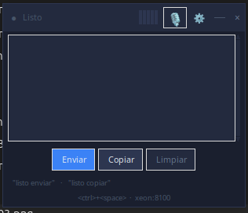

# 🎙 Dictado por Voz en Español

Widget flotante de dictado por voz para Linux.  
Captura audio del micrófono, lo envía a un servidor Vosk vía WebSocket y
transcribe el texto en tiempo real directamente en la pantalla.

**Autor:** enlinea777@gmail.com  
**Licencia:** [GNU General Public License v3.0](https://www.gnu.org/licenses/gpl-3.0.html)  
**Servidor backend:** https://github.com/enlinea777/docker_vos_a_texto

---

## ¿Qué hace este programa?

- Muestra una **ventana flotante sin bordes** siempre visible sobre otras ventanas.
- Al presionar **Ctrl+Space** (o el atajo configurado) comienza a grabar.
- El audio se envía al servidor Vosk mediante WebSocket y la transcripción
  aparece en tiempo real dentro del widget.
- Admite **comandos de voz**:
  - `"listo enviar"` → escribe el texto transcrito donde esté el cursor del sistema.
  - `"listo copiar"` → copia el texto al portapapeles.
- El texto puede **editarse manualmente** haciendo clic en el área de transcripción.
- Incluye **icono en bandeja del sistema** (clic derecho → Mostrar/Ocultar o Salir).
- Los logs se guardan en `~/.config/vosk-dictado/dictado.log`.

---

## Interfaz





- **●** — indicador de estado (gris = listo, verde = grabando, rojo = error).
- **VU** — medidor de nivel de audio en tiempo real (5 barras verticales).
- **🎙** — inicia o detiene la grabación.
- **⚙** — abre la configuración (servidor, puerto, atajo, créditos).
- **─ / ×** — ocultan la ventana (el proceso sigue corriendo en bandeja).

---

## Requisitos del sistema

```bash
# X11
sudo apt install python3-tk python3-venv xdotool xclip libportaudio2
# Wayland (además)
sudo apt install wl-clipboard
```

| Dependencia | Versión mínima | Licencia |
|---|---|---|
| Python 3 | 3.9 | PSF |
| Tkinter / Tcl-Tk | incluido | Tcl |
| sounddevice | ≥ 0.4.6 | MIT |
| websocket-client | ≥ 1.6.0 | Apache 2.0 |
| numpy | ≥ 1.24 | BSD 3-Clause |
| pynput | ≥ 1.7.6 | LGPLv3 |
| python-xlib | ≥ 0.33 | LGPLv2+ |
| pystray | ≥ 0.19 | LGPLv3 |
| Pillow | ≥ 9.0 | HPND |
| pyperclip | ≥ 1.8.2 | BSD 3-Clause |
| dbus-fast | ≥ 5.0 | MIT |
| evdev | ≥ 1.6 | BSD 3-Clause |
| xdotool | cualquiera | MIT |
| wl-clipboard | cualquiera | MIT |

---

## Instalación

### Opción A — Paquetes de la release (recomendado)

Cada etiqueta `v*` publica automáticamente (GitHub Actions) los paquetes de
las tres familias en **Releases**:

| Distro | Archivo | Instalación |
|---|---|---|
| Debian / Ubuntu | `dictado_*_all.deb` | `sudo apt install ./dictado_*_all.deb` |
| Fedora | `dictado-*.noarch.rpm` | `sudo dnf install ./dictado-*.noarch.rpm` |
| Arch Linux | `dictado-*.pkg.tar.zst` | `sudo pacman -U ./dictado-*.pkg.tar.zst` |
| Windows 10/11 | `dictado-*-setup.exe` | ejecutar el instalador (siguiente, siguiente) |
| macOS Intel / Apple Silicon | `Dictado-*-macos-x86_64.dmg` / `-macos-arm64.dmg` | abrir el DMG y arrastrar a *Aplicaciones* |
| Linux (AppImage, x86_64/ARM) | `dictado-*-x86_64.AppImage` / `-aarch64.AppImage` | `chmod +x` y ejecutar |
| Linux (Flatpak) | `dictado-*-x86_64.flatpak` / `-aarch64.flatpak` | `flatpak install ./dictado-*.flatpak` |

Los paquetes `.deb`, `.rpm` y de Arch son **independientes de la arquitectura**
(`all`/`noarch`), así que el mismo archivo sirve en x86_64 y en ARM.

Los tres paquetes instalan el lanzador `/usr/bin/dictado`, la entrada de menú
y el icono, y crean el entorno Python en `/var/lib/dictado/venv` durante la
instalación (necesita conexión a internet la primera vez).

### Opción B — Paquete `.deb` construido localmente (Ubuntu / Debian)

```bash
# 1. Construir el paquete
cd vosk-dictado
./build-deb.sh

# 2. Instalar
sudo dpkg -i deb-build/dictado_1.1.0_all.deb
sudo apt-get install -f   # instala dependencias del sistema si faltan

# 3. Ejecutar
dictado
# o desde el menú de aplicaciones: "Dictado por Voz"
```

El instalador crea automáticamente el entorno virtual Python en
`/var/lib/dictado/venv` e instala todas las dependencias pip.

### Windows (instalador)

Descarga `dictado-<versión>-setup.exe` de la release y ejecútalo. El
instalador (Inno Setup) copia `Dictado.exe` (generado con PyInstaller, sin
necesidad de tener Python instalado), crea el acceso en el menú de inicio,
opcionalmente en el escritorio, y añade el desinstalador.

En Windows la app usa la API nativa:

| Función | Linux | Windows | macOS |
|---|---|---|---|
| Atajo global | portal GlobalShortcuts / XGrabKey | hook de teclado (`pynput`) | `pynput` |
| Enviar texto | teclado virtual `uinput` | `SendInput` (`KEYEVENTF_UNICODE`) | portapapeles + `Cmd+V` |
| Pegar (modo alternativo) | `wl-copy` + `shift+insert` | portapapeles + `Ctrl+V` | portapapeles + `Cmd+V` |
| Bandeja del sistema | AppIndicator | bandeja nativa (`pystray`) | barra de menús (`pystray`) |
| Configuración/log | `~/.config/vosk-dictado/` | `%APPDATA%\vosk-dictado\` | `~/Library/Application Support/vosk-dictado/` |

El texto se escribe carácter a carácter con `SendInput` Unicode, así que las
tildes y la ñ funcionan en cualquier ventana, incluida la consola.

### macOS (DMG)

Descarga `Dictado-<versión>-macos-arm64.dmg` (Apple Silicon) o
`-macos-x86_64.dmg` (Intel), ábrelo y arrastra *Dictado* a *Aplicaciones*.
La app va firmada ad-hoc (sin notarizar): la primera vez hay que abrirla con
clic derecho → *Abrir*, o ir a *Ajustes → Privacidad y seguridad → Abrir
igual*.

Permisos necesarios en macOS:
- **Micrófono** (se pide al empezar a grabar).
- **Accesibilidad**: para el atajo global y para pegar con `Cmd+V`
  (*Ajustes → Privacidad y seguridad → Accesibilidad*).

El atajo por defecto en macOS es `Ctrl+Alt+Espacio` (porque `Ctrl+Espacio`
lo usa Spotlight) y el texto se envía con el portapapeles + `Cmd+V`.

### Linux ARM (aarch64)

No hace falta un paquete distinto: el `.deb`, el `.rpm` y el paquete de Arch
son `all`/`noarch` y funcionan igual en Raspberry Pi, servidores ARM, etc.
Las dependencias (numpy, Pillow, sounddevice, evdev, dbus-fast) se instalan
desde PyPI con ruedas `aarch64`. Para AppImage y Flatpak sí hay builds
específicos `aarch64`.

### AppImage

`dictado-<versión>-<arch>.AppImage` es un único archivo ejecutable con Python
y todas las dependencias dentro:

```bash
chmod +x dictado-*-x86_64.AppImage
./dictado-*-x86_64.AppImage
```

Necesita `libfuse2` para ejecutarse en Ubuntu 22.04+ (`sudo apt install libfuse2`),
o usar `--appimage-extract-and-run`. El atajo global funciona igual (portal en
Wayland / XGrabKey en X11).

### Flatpak

```bash
flatpak install ./dictado-<versión>-x86_64.flatpak
flatpak run io.github.enlinea777.Dictado
```

El manifiesto (`packaging/flatpak/io.github.enlinea777.Dictado.yml`) está
preparado para **Flathub**: incluye metainfo AppStream, icono, `.desktop` con
el app id y `finish-args` para micrófono (`--socket=pulseaudio`), `uinput`
(`--device=all`), portal de atajos y bandeja. Para publicar en Flathub hay que
enviar ese manifiesto mediante un PR a
[flathub/flathub](https://github.com/flathub/flathub) apuntando a un tag del
repo (Flathub no se puede automatizar desde este CI).

Dentro del sandbox el texto se envía **pegando** (`wl-clipboard` va incluido en
el bundle), porque no hay `xmodmap` para leer la distribución de teclado.

### Opción C — Script portable (sin instalación)

```bash
./dictado-portable.sh
```

Extrae `dictado.py`, instala un venv local si no existe, y ejecuta el programa.

### Opción D — Desde fuente

```bash
cd vosk-dictado
./install.sh      # crea venv y pip install
./run.sh          # lanza el programa
```

---

## Configuración

Al hacer clic en **⚙** se abre el diálogo de configuración:

| Campo | Valor por defecto | Descripción |
|---|---|---|
| Host / IP | `xeon` | Hostname o IP del servidor backend |
| Puerto | `8085` | Puerto HTTP/WS del node-gateway |
| Combinación | `<ctrl>+<space>` | Atajo global para iniciar/detener |
| Copiar texto | `<ctrl>+<alt>+c` | Atajo global que copia la transcripción (útil en Wayland) |
| Modo | `escribir` | (Wayland) escribir con teclado virtual o `pegar` con el portapapeles |
| Tecla de pegado | `shift+insert` | (Wayland, modo pegar) tecla que se pulsa tras copiar |
| Tecla (apps) | `ctrl+v` | (X11) tecla de pegado en aplicaciones normales |
| Tecla (terminales) | `ctrl+shift+v` | (X11) tecla de pegado en terminales |

El archivo de configuración se guarda en `~/.config/vosk-dictado/config.ini`.

---

## Wayland

La app funciona igual en X11 y en Wayland, pero cada sesión usa un mecanismo
distinto para el atajo global y para pegar el texto:

| | X11 | Wayland (GNOME) |
|---|---|---|
| Atajo global | `XGrabKey` (python-xlib) | Portal `org.freedesktop.portal.GlobalShortcuts` + `XGrabKey` de respaldo |
| Pegar texto | `xdotool` (XTest) | Portapapeles (`wl-copy`) + `uinput` (`evdev`) |
| Permisos | ninguno | ninguno (`/dev/uinput` es del usuario de la sesión) |

### Atajo global en Wayland

El atajo se registra en GNOME mediante el portal **GlobalShortcuts**, así que
aparece en *Ajustes → Teclado → Atajos de teclado* y se puede reasignar allí.

Para ello el portal necesita un **app id**, que systemd deduce del scope
`app-<id>-<aleatorio>.scope`. Los lanzadores (`run.sh`, `dictado-portable.sh`
y `/usr/bin/dictado`) relanzan la app dentro de un scope
`app-dictado-*.scope` automáticamente si hace falta. Lanzar la app desde el
menú de GNOME también funciona.

Si el portal no está disponible (por ejemplo, ejecutando `dictado.py` a mano
desde una terminal) queda el respaldo `XGrabKey`, que sólo alcanza a
aplicaciones X11 (incluidas las que corren bajo XWayland).

### Enviar el texto en Wayland

En Wayland no existe una API pública para saber qué ventana tiene el foco y
por tanto no se puede detectar si es una terminal. Por eso, por defecto el
texto **se escribe tecla a tecla con un teclado virtual** (`uinput` +
`python-evdev`): llega igual a terminales y a cualquier aplicación, como si
lo escribiera una persona, sin depender del portapapeles.

- Cada carácter se traduce a su tecla real usando el **mapa de teclado
  activo** (`xmodmap`), así que respeta la distribución configurada.
- Las letras acentuadas se escriben con su **tecla muerta** (`´` + `a` = `á`),
  igual que al teclear a mano.
- Velocidad: ~50 caracteres/s (20 ms por tecla; 140 ms tras una tecla muerta).

En ⚙ (*Modo*) se puede cambiar a **Pegar (portapapeles)**, que copia el texto
con `wl-copy` y pulsa `shift+insert`. Es más rápido con textos largos, pero
depende de que la app acepte esa tecla de pegado.

`xdotool type` y `xdotool key` **no** sirven para Wayland: sólo afectan a
clientes X11. Por eso no se usan en este modo.

---

## Servidor backend — ¿A dónde se conecta?

El programa se conecta al **node-gateway** del proyecto
[docker_vos_a_texto](https://github.com/enlinea777/docker_vos_a_texto) mediante:

```
WebSocket:  ws://HOST:PUERTO/ws
Health:     http://HOST:PUERTO/health
```

### Opción 1 — Servidor Docker local (recomendado para uso privado)

```bash
git clone https://github.com/enlinea777/docker_vos_a_texto
cd docker_vos_a_texto
docker compose up -d
```

El servidor queda disponible en `ws://localhost:8085/ws`.  
Requiere **mínimo 1 GB de RAM** para el modelo Vosk español v0.42.

Luego configura el cliente:
- Host: `localhost`
- Puerto: `8085`

### Opción 2 — Servicio público (disponible en línea)

El servidor está disponible públicamente en:

```
ws://asistente.nxd.cl:8100/ws       (HTTP/WS)
```

Configura el cliente con el host y puerto que corresponda a tu instalación.

### Arquitectura del servicio

```
[dictado.py]
    │
    │  WebSocket (audio PCM 16-bit, 16 kHz, mono)
    ▼
[node-gateway  :8100]          ← Node.js, expuesto al exterior
    │
    │  WebSocket interno
    ▼
[vosk-server   :2700]          ← Vosk STT (solo interno, no expuesto)
    │
    ▼
transcripción en texto  →  node-gateway  →  dictado.py
```

| Puerto | Protocolo | Descripción |
|---|---|---|
| 8100 | HTTP / WS | Comunicación principal con el cliente |
| 2700 | WS interno | Vosk STT (solo dentro del contenedor) |

---

## Formato de audio

| Parámetro | Valor |
|---|---|
| Formato | PCM lineal 16-bit |
| Frecuencia de muestreo | 16 000 Hz |
| Canales | Mono |
| Codificación | Little-endian |

---

## Copiar el texto transcrito

- Selecciona con el ratón y pulsa **Copiar**, o usa el **clic derecho →
  Copiar / Seleccionar todo / Limpiar**.
- Con teclado: `Ctrl+C` copia la selección (o todo el texto) y `Ctrl+A`
  selecciona todo, **en X11**.
- **En Wayland la ventana sin bordes no puede recibir el foco del teclado**
  (GNOME no deja enfocar ventanas no gestionadas), así que `Ctrl+C` no llega
  a la app. Para eso está el atajo global **`Ctrl+Alt+C`**, que copia el texto
  aunque la ventana no tenga el foco (aparece en Ajustes → Teclado y se puede
  reasignar).

---

## Comandos de voz

| Frase | Acción |
|---|---|
| `"listo enviar"` | Escribe el texto transcrito en la ventana activa del sistema |
| `"listo copiar"` | Copia el texto al portapapeles y oculta la ventana |

---

## Archivos del proyecto

```
vosk-dictado/
├── dictado.py            # Programa principal (Python + Tkinter)
├── run.sh                # Script de lanzamiento (venv local)
├── install.sh            # Instalador de dependencias en venv local
├── requirements.txt      # Dependencias pip
├── build-deb.sh          # Genera el paquete .deb instalable
├── dictado-portable.sh   # Script portable autocontenido
├── packaging/
│   ├── dictado.desktop   # Entrada de menú compartida
│   ├── launcher.sh       # Lanzador para rpm/Arch
│   ├── icon/dictado.png  # Icono 128x128
│   ├── rpm/dictado.spec  # Empaquetado Fedora/RHEL
│   ├── arch/             # PKGBUILD + .INSTALL (Arch Linux)
│   ├── windows/dictado.iss  # Instalador de Windows (Inno Setup)
│   ├── appimage/         # AppRun + .desktop del AppImage
│   ├── flatpak/          # Manifiesto, metainfo y lanzador del Flatpak
│   └── icon/dictado.{png,ico,icns}
├── .github/workflows/release.yml  # CI: deb + rpm + Arch → Release
└── README.MD             # Este archivo
```

### Publicar una release

```bash
git tag v1.1.0
git push origin v1.1.0
```

GitHub Actions construye los paquetes en entornos limpios: `.deb`
(`ubuntu-latest`), `.rpm` (`fedora:latest`), Arch (`archlinux:latest`),
instalador de Windows (`windows-latest`, PyInstaller + Inno Setup), DMG de
macOS (`macos-13` Intel y `macos-14` ARM con PyInstaller), AppImage y Flatpak
en x86_64 y aarch64 (`ubuntu-latest` / `ubuntu-24.04-arm`), y los adjunta a la
release junto con `dictado-portable.sh`. También se puede lanzar a mano desde
*Actions → Release → Run workflow*.

---

## Solución de problemas

| Síntoma | Causa probable | Solución |
|---|---|---|
| `Error: No se puede alcanzar http://...` | Servidor apagado o IP/puerto incorrectos | Verificar host/puerto en ⚙ |
| Sin audio / VU no reacciona | Micrófono no disponible o driver ALSA | `arecord -l` para listar dispositivos |
| Ventana no aparece al presionar hotkey | Conflicto con otro programa | Cambiar la combinación en ⚙ |
| El texto no se escribe en otro programa | `xdotool` no instalado (X11) | `sudo apt install xdotool` |
| Wayland: el atajo no responde | app sin *app id* (lanzada a mano desde una terminal) | usar `./run.sh` (relanza en scope systemd) o el menú de GNOME |
| Wayland: el atajo no aparece en Ajustes | portal/backend no disponible | `systemctl --user restart xdg-desktop-portal-gnome`; revisar log |
| Wayland: el texto no se pega | `wl-copy`/`/dev/uinput` sin acceso | `sudo apt install wl-clipboard`; comprobar `ls -l /dev/uinput` |
| Wayland: el texto no llega a la terminal | modo «pegar» y la terminal no acepta la tecla | dejar el modo «Escribir» (por defecto) en ⚙ |
| Wayland: faltan letras acentuadas | el mapa de teclado no tiene esa tecla muerta | revisar la distribución con `setxkbmap -query` |
| Wayland: `Ctrl+C` no copia dentro del widget | ventana sin bordes = sin foco de teclado | usar el botón Copiar, clic derecho o `Ctrl+Alt+C` |
| La ventana crece y los botones se ven | corregido: la ventana crece y las barras quedan ancladas abajo | — |
| Tras actualizar Python (`3.12` → `3.14`) la app no arranca | venv de la versión anterior | `./install.sh` (recrea el venv); en el `.deb`, `sudo apt install --reinstall dictado` |
| Icono en bandeja no aparece | GNOME sin extensión AppIndicator | Instalar "AppIndicator and KStatusNotifierItem Support" |

Los logs detallados están en `~/.config/vosk-dictado/dictado.log`.

---

## Créditos y licencias de componentes

Este proyecto es software libre distribuido bajo **GNU GPL v3**.

| Componente | Proyecto | Licencia |
|---|---|---|
| Reconocimiento de voz | [Vosk](https://alphacephei.com/vosk/) (modelo es v0.42) | Apache 2.0 / CC BY-NC-ND 4.0 |
| Node.js Gateway | [docker_vos_a_texto](https://github.com/enlinea777/docker_vos_a_texto) | GNU GPLv3 |
| Python 3 | python.org | PSF License |
| Tkinter / Tcl-Tk | tcl.tk | Tcl License |
| sounddevice | spatialaudio/python-sounddevice | MIT |
| websocket-client | websocket-client/websocket-client | Apache 2.0 |
| NumPy | numpy.org | BSD 3-Clause |
| pynput | moses-palmer/pynput | LGPLv3 |
| python-xlib | python-xlib/python-xlib | LGPLv2+ |
| pystray | moses-palmer/pystray | LGPLv3 |
| Pillow | python-pillow/Pillow | HPND |
| pyperclip | asweigart/pyperclip | BSD 3-Clause |
| dbus-fast | dbus-fast/dbus-fast | MIT |
| python-evdev | gvalkov/python-evdev | BSD 3-Clause |
| xdotool | jordansissel/xdotool | MIT |
| wl-clipboard | bugaevc/wl-clipboard | MIT |

```
Copyright (C) 2026  enlinea777@gmail.com

Este programa es software libre: puedes redistribuirlo y/o modificarlo
bajo los términos de la Licencia Pública General de GNU publicada por
la Free Software Foundation, versión 3 cualquier
versión posterior.

Este programa se distribuye con la esperanza de que sea útil,
pero SIN NINGUNA GARANTÍA; sin incluso la garantía implícita de
COMERCIABILIDAD o IDONEIDAD PARA UN PROPÓSITO PARTICULAR.
Consulta la GNU GPL para más detalles: https://www.gnu.org/licenses/
```
